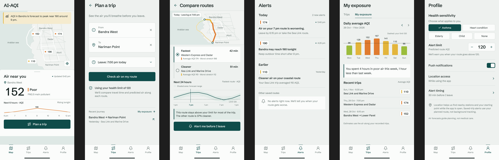

# AI-AQI Environmental Dashboard

AI-AQI uses a user-approved device location to show nearby air-quality stations, a current WAQI AQI reading, available pollutant sub-index values, and local weather. The current milestone is a location-aware dashboard; route planning, forecasting, alerts, and user profiles remain future work.

<p align="center"></p>

## Current dashboard

- High-accuracy browser geolocation with standard-accuracy fallback.
- Current AQI, category, dominant pollutant, source station, and observation time.
- Available PM2.5, PM10, NO2, O3, and CO values from WAQI.
- Current weather from OpenWeatherMap.
- A Leaflet map with the device location and nearby WAQI stations.
- Progressive 10–100 km station search and clearly labelled inverse-distance AQI estimates when multiple stations are available.
- A visible no-data state or station-distance/confidence message when a nearby measured AQI cannot be used directly.
- Partial responses and per-section retry states when an external provider is unavailable.
- Environmental readings written to InfluxDB Cloud.

WAQI's pollutant values are shown as provider sub-index values when that is what the response contains. They are not represented as raw concentration measurements.

## Run locally

Python, pip, Node.js, and npm are required. Put the following service credentials in `backend/.env`; never commit this file:

```dotenv
INFLUXDB_URL=...
INFLUXDB_TOKEN=...
INFLUXDB_ORG=...
INFLUXDB_BUCKET=aqi_data
WAQI_API_TOKEN=...
OPENWEATHERMAP_API_KEY=...
TOMTOM_API_KEY=...
```

Start the backend from the repository root:

```powershell
.\venv\Scripts\Activate.ps1
cd backend
uvicorn main:app --reload
```

In another terminal, start the frontend:

```powershell
cd frontend
npm install
npm run dev
```

Open the URL printed by Vite. The frontend calls FastAPI at `http://127.0.0.1:8000` by default; set `VITE_API_BASE_URL` to use a different backend URL. Browser location access requires user permission and a secure browser context such as localhost or HTTPS.

## Verification

With the backend running and `venv` available from the repository root:

```powershell
.\venv\Scripts\python.exe scripts\verify_database.py
.\venv\Scripts\python.exe scripts\e2e_test.py
```

The scripts write reports to `docs/db_verification_report.md` and `docs/e2e_test_results.md`. See [technical documentation](docs/TECHNICAL_DOCUMENTATION.md), [milestone review](docs/MILESTONE1_REVIEW.md), and the [submission checklist](submission/CHECKLIST.md) for setup details and remaining manual artifacts.

## Stack

React, TypeScript, Vite, Leaflet, FastAPI, HTTPX, WAQI, OpenWeatherMap, TomTom Traffic, and InfluxDB Cloud.
