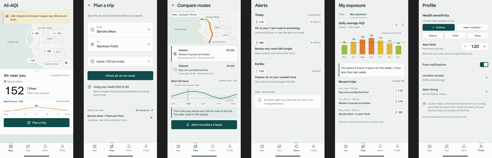

# AI-AQI Environmental Dashboard

AI-AQI is a location-aware air quality dashboard. With the user's permission, it loads nearby AQI and weather data, displays monitoring stations on a map, and provides health-sensitive AQI guidance for signed-in users.

<p align="center"></p>

## Features

- Browser geolocation with a high-accuracy request and a standard-accuracy fallback.
- Current AQI, dominant pollutant, source station, and observation time from WAQI.
- Nearby station map and spatial AQI estimation when multiple station readings are available.
- Weather data from OpenWeatherMap and traffic flow data from TomTom.
- Per-source status and clear loading, retry, and no-data states.
- Optional account registration, login, health sensitivity settings, and personalized AQI advisories.
- SQLite storage for account and health profile data.
- InfluxDB Cloud storage for environmental readings and authenticated location history.

Trips and Alerts are navigation placeholders and are not implemented yet. The traffic index is estimated from current speed compared with free-flow speed; it may be unavailable when the traffic provider has no usable road-segment data.

## Technology

- Frontend: React, TypeScript, Vite, Leaflet
- Backend: Python, FastAPI, Pydantic, HTTPX
- Storage: SQLite for user profiles; InfluxDB Cloud for time-series readings
- Data providers: WAQI, OpenWeatherMap, TomTom Traffic
- Authentication: JWT bearer tokens

## Requirements

- Python 3.10 or newer
- Node.js and npm
- API credentials for the external data providers you want to use
- An InfluxDB Cloud bucket for environmental readings and location history

## Configuration

Create `backend/.env` with the credentials used by the backend:

```dotenv
WAQI_API_TOKEN=your-waqi-token
OPENWEATHERMAP_API_KEY=your-openweathermap-key
TOMTOM_API_KEY=your-tomtom-key

INFLUXDB_URL=your-influxdb-url
INFLUXDB_TOKEN=your-influxdb-token
INFLUXDB_ORG=your-influxdb-org
INFLUXDB_BUCKET=aqi_data

JWT_SECRET=replace-with-a-random-secret-at-least-32-bytes-long
```

Keep real credentials out of Git. SQLite creates `backend/users.db` automatically when the backend starts; that local database file is ignored by Git.

## Run locally

From the repository root, create and activate a virtual environment, then install the backend requirements:

```powershell
python -m venv .venv
.\.venv\Scripts\Activate.ps1
python -m pip install -r requirements.txt
```

Start FastAPI from the `backend` directory:

```powershell
cd backend
uvicorn main:app --reload
```

In a second terminal, install frontend dependencies and start Vite:

```powershell
cd frontend
npm ci
npm run dev
```

Open the local URL printed by Vite. The Vite development server proxies API requests to `http://127.0.0.1:8000`. Browser location access requires user permission and a secure context; `localhost` is treated as secure by modern browsers.

## API overview

FastAPI interactive documentation is available at `http://127.0.0.1:8000/docs` while the backend is running.

| Endpoint | Purpose |
| --- | --- |
| `GET /health` | Backend and InfluxDB connectivity status |
| `GET /api/aqi/current` | Current AQI and nearby station quality details |
| `GET /api/aqi/stations` | Nearby monitoring stations |
| `GET /api/environment/combined` | AQI, weather, traffic, and source status in one response |
| `POST /auth/register` and `POST /auth/login` | Create an account or sign in |
| `GET /users/me` | Read the authenticated user's profile |
| `PUT /users/me/health-profile` | Update health sensitivity settings |
| `POST /users/me/evaluate` | Get a personalized advisory for an AQI value |
| `POST /location/update` | Save the authenticated user's location history |

Location and combined environment endpoints accept latitude and longitude query parameters where applicable. Authenticated endpoints require a bearer token.

## Build and checks

Build the frontend:

```powershell
cd frontend
npm run build
```

Optional repository verification scripts can be run from the root with the project virtual environment active:

```powershell
python scripts/verify_database.py
python scripts/e2e_test.py
```

Project notes and milestone material are in [technical documentation](docs/TECHNICAL_DOCUMENTATION.md), [milestone review](docs/MILESTONE1_REVIEW.md), and the [submission checklist](submission/CHECKLIST.md).
