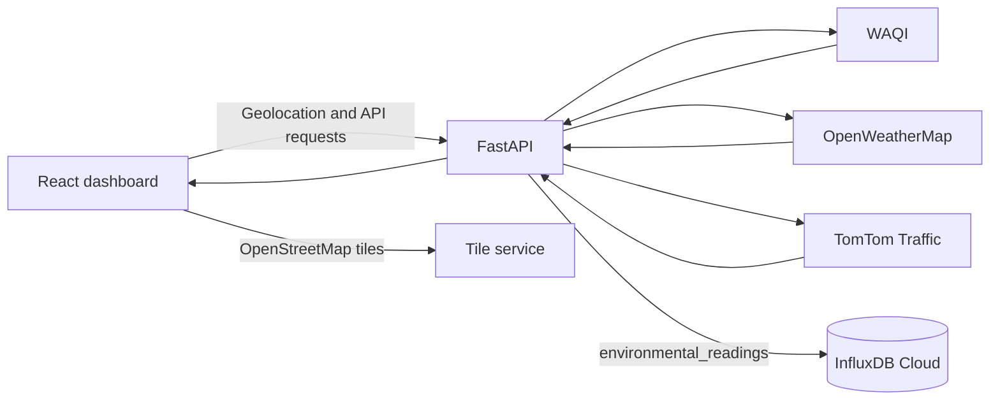

# Technical Documentation

## Overview

AI-AQI is a location-aware air-quality dashboard for the Weeks 1–2 milestone. The browser obtains the user's location with permission; the FastAPI backend combines WAQI air-quality, OpenWeatherMap weather, and TomTom traffic responses and stores readings in InfluxDB Cloud. The frontend also requests nearby WAQI monitoring stations for the map.

## Architecture



The three provider requests run independently. A provider failure is represented in `data_quality`; available sources still return. API and provider calls use bounded HTTP timeouts.

## Repository layout

```text
backend/
  main.py
  db_service.py
  router/                 FastAPI route modules
  services/               WAQI, weather, traffic, aggregation
  .env                    Local credentials; ignored by Git
frontend/
  src/components/dashboard/  Dashboard sections and map
  src/hooks/useGeolocation.ts
  src/services/api.ts
scripts/                  Database and end-to-end verification
docs/                     Verification reports and project documentation
submission/               Final artifact checklist
```

## Setup

Use Python and Node.js/npm. From the repository root, create or activate the existing virtual environment and install backend requirements if needed:

```powershell
.\venv\Scripts\Activate.ps1
pip install -r requirements.txt
```

Put credentials in `backend/.env`:

```dotenv
INFLUXDB_URL=https://...
INFLUXDB_TOKEN=...
INFLUXDB_ORG=...
INFLUXDB_BUCKET=aqi_data
WAQI_API_TOKEN=...
OPENWEATHERMAP_API_KEY=...
TOMTOM_API_KEY=...
```

Never commit `.env`. Run the API from `backend/`:

```powershell
cd backend
uvicorn main:app --reload
```

In a separate terminal:

```powershell
cd frontend
npm install
npm run dev
```

The browser must grant geolocation permission. `localhost` is considered a secure context by modern browsers. The frontend calls FastAPI at `http://127.0.0.1:8000` by default; set `VITE_API_BASE_URL` in the frontend environment to use another API origin. Cross-origin deployments must configure the backend CORS origins to include the frontend origin.

## API reference

### `GET /health`

Returns API status and an InfluxDB health indicator.

```json
{"status":"healthy","database_connected":true}
```

### `GET /api/aqi/current?lat=19.07&lon=72.87`

Returns a direct WAQI station reading or a distance-weighted estimate based on nearby WAQI station AQIs. Existing `aqi`, `dominentpol`, and `city` fields are retained; the response also includes the pollutant object, source timestamp, and spatial quality metadata. Coordinates outside latitude/longitude bounds produce HTTP 400; provider failures produce HTTP 502.

```json
{
  "aqi": 82,
  "dominentpol": "pm25",
  "city": {"name": "Example station"},
  "pollutants": {
    "pm25": {"value": 82, "unit": "WAQI sub-index"},
    "pm10": null,
    "no2": null,
    "o3": null,
    "co": null
  },
  "source_timestamp": "2026-11-11T10:00:00+05:30",
  "data_quality": {"method": "idw_interpolated", "nearest_station_km": 8.4, "confidence": "high", "stations_used": 3, "search_radius_km": 10}
}
```

### `GET /api/environment/combined?lat=19.07&lon=72.87`

Returns the original `location`, `aqi`, `weather`, `traffic`, and `timestamp` keys plus `pollutants`, `source_timestamp`, `stations`, `request_timestamp`, and per-source `data_quality`. AQI quality includes the selection method, nearest station distance, confidence, station count, and search radius. An unavailable provider has a null data section and a status/message in `data_quality`; a provider outage does not fail the whole response. A completed combined request attempts to write a point to InfluxDB.

```json
{
  "location": {"lat": 19.07, "lon": 72.87},
  "aqi": {"aqi": 82, "dominentpol": "pm25", "city": {"name": "Example station"}},
  "weather": {"temperature": 30.0, "humidity": 65},
  "traffic": {"traffic_index": 4},
  "pollutants": {"pm25": {"value": 82, "unit": "WAQI sub-index"}, "pm10": {"value": null, "unit": "WAQI sub-index"}, "no2": {"value": null, "unit": "WAQI sub-index"}, "o3": {"value": null, "unit": "WAQI sub-index"}, "co": {"value": null, "unit": "WAQI sub-index"}},
  "source_timestamp": "2026-11-11T10:00:00+05:30",
  "timestamp": 0,
  "request_timestamp": "2026-11-11T10:00:01+05:30",
  "data_quality": {
    "method": "idw_interpolated",
    "nearest_station_km": 8.4,
    "confidence": "high",
    "aqi": {"status": "ok", "message": null, "method": "idw_interpolated", "nearest_station_km": 8.4, "confidence": "high", "stations_used": 3, "search_radius_km": 10},
    "weather": {"status": "ok", "message": null},
    "traffic": {"status": "ok", "message": null}
  },
  "stations": []
}
```

AQI spatial selection tries progressively larger WAQI map-feed radii (10, 25, 50, and 100 km). A reading within 0.5 km is treated as a direct station reading. With two or more reporting stations, the API calculates an inverse-square distance-weighted estimate; with one station, it reports that station's value without calling it an interpolation. If no usable AQI is found within 100 km, `aqi` is null and `data_quality.aqi.method` is `no_data`. Confidence is based on distance to the nearest reporting station: high under 10 km, medium under 50 km, and low otherwise. The UI labels estimates and shows distance/confidence.

### `GET /api/aqi/stations?lat=19.07&lon=72.87&radius_km=25`

Returns nearby WAQI stations with station name, coordinates, available AQI/pollutant sub-indices, and source update time. `radius_km` is bounded by the API. Station data depends on WAQI map-feed availability.

Existing `POST /location/update`, `POST /users/register`, and `GET /users/{username}` endpoints remain available.

## External services and data interpretation

- **WAQI:** current station readings and nearby map data. WAQI describes its `iaqi` entries as individual pollutant AQI values; these values must not be labelled raw µg/m³ concentrations. The dashboard identifies them as provider sub-indices when units are not supplied. WAQI API documentation: <https://aqicn.org/api/>.
- **OpenAQ:** not queried by this feature. The proposed v2 locations endpoint is retired. OpenAQ v3 exposes locations and latest sensor measurements; its latest values are pollutant concentrations, not the WAQI AQI index used by this dashboard. Mixing those values into AQI interpolation without pollutant-specific standards conversion would be invalid. References: <https://docs.openaq.org/about/about>, <https://docs.openaq.org/resources/locations>, and <https://docs.openaq.org/resources/latest>.
- **OpenWeatherMap:** current weather data from the configured key.
- **TomTom:** traffic/jam-factor data from the configured key.
- **InfluxDB Cloud:** persistence and verification of environmental readings.
- **OpenStreetMap tiles:** map rendering; tile usage is subject to the tile provider's policy and attribution requirements.

## InfluxDB schema

- Bucket: `INFLUXDB_BUCKET` (project default `aqi_data`)
- Measurement: `environmental_readings`
- Tag: `location` as `latitude,longitude`
- Fields: `aqi` (AQI index), `temperature` (°C), `humidity` (%), `traffic_index` (unitless TomTom jam factor)
- Timestamp: UTC write time
- Retention: configured on the Cloud bucket; the application does not set retention.

The database verification script queries the last 24 hours and records observed retention and field data in `docs/db_verification_report.md`.

## Known limitations

- Desktop location can be approximate because browsers may estimate it from Wi-Fi or IP-derived signals. High accuracy is requested, with a standard accuracy fallback; a browser cannot force GPS hardware to be available.
- Provider quotas, API keys, network availability, and station coverage affect the returned data.
- Some stations do not report every pollutant, including ozone. Missing readings are shown as em dashes.
- IDW is a spatial estimate from current WAQI station AQIs, not an official reading at the user's coordinates; its accuracy depends on station density and source freshness.
- WAQI pollutant sub-indices are not concentration measurements unless the provider explicitly supplies concentration units.
- Manual location search, IP-location comparison, forecasting, route advice, and push notifications are outside this milestone.
